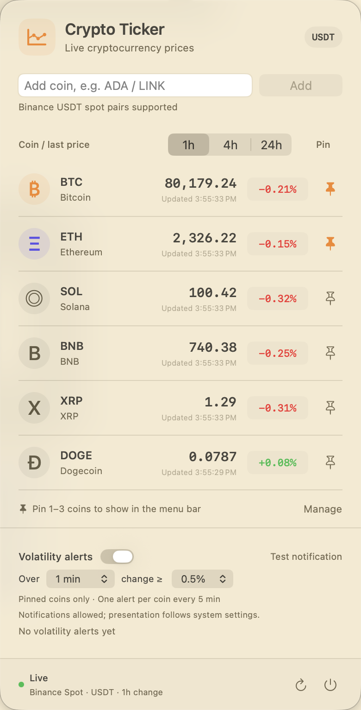

# Crypto Ticker

English | [简体中文](README.zh-CN.md)

**Live cryptocurrency prices in your macOS menu bar, with alerts for sharp price moves.**

Crypto Ticker is a native menu bar app built with Swift, AppKit, and SwiftUI. Pin the coins you follow to see prices and price-change directions without switching windows. Click the menu bar prices to open your watchlist, choose a change window, and configure volatility alerts.

Requires **macOS 13+**. Prices come from Binance's public spot market feeds and are quoted in **USDT**. No account, API key, or third-party dependencies are required.

The app follows the macOS system language, supporting **English and Simplified Chinese**, with English as the fallback when no supported language matches. Restart the app after changing the system or per-app language. The interface, errors, accessibility labels, and notifications use the same language.

## Screenshots

**Full menu bar:** pinned coins, live prices, the selected change window, and price-change directions. Click the image to view it at full size.

<p>
  <a href="docs/images/menu-bar.png"></a>
</p>

**Market panel:** manage coins, switch between 1h / 4h / 24h changes, and configure short-term volatility alerts.

<p>
  
</p>

Screenshots show the running app. Prices and alert settings reflect the state at the time of capture.

## Features

| Feature | Details |
| --- | --- |
| Live prices | WebSocket updates about once per second, with a REST snapshot on connection |
| Custom watchlist | Track up to 50 coins with Binance USDT spot pairs |
| Menu bar pins | Show 1–3 coins at once; watchlist and pin selections are saved automatically |
| Change windows | Choose 1h, 4h, or 24h; percentages, colors, and menu bar arrows update together |
| Volatility alerts | Monitor pinned coins with adjustable durations and thresholds; switch alerts on or off |
| System notifications | macOS notifications and sounds, with a **Test notification** button |
| System language | Automatically follows English or Simplified Chinese language preferences |
| Native interaction | No Dock icon; stable popover position, scrollbars hidden until scrolling, and input focus only on click |
| Connection recovery | Automatic reconnection, stale-data indicators, and sleep/wake handling |

## Quick start

Install Xcode or Command Line Tools with Swift 5.9+ on macOS 13 or later. From the project root, run:

```sh
zsh scripts/build-app.sh
open "dist/Crypto Ticker.app"
```

The built app is at `dist/Crypto Ticker.app`. You can also double-click it or move it to your Applications folder.

Prices appear in the menu bar at the top of the screen. Click them to open the panel, and use the power button at the bottom right of the panel to quit. The app does not show a Dock icon.

## Usage

### Manage your watchlist

The default watchlist contains BTC, ETH, SOL, BNB, XRP, and DOGE, with BTC pinned initially.

1. Enter a symbol such as `ADA`, `LINKUSDT`, or `ADA/USDT`, then click **Add**. The app validates the trading pair before subscribing to its feed.
2. Click a coin's pin button to show it in the menu bar. You can pin up to 3 coins and must keep at least 1 pinned.
3. Click **Manage** to remove coins. At least 1 coin must remain in the watchlist. Removing the last pinned coin automatically pins the first remaining coin.

Use a mouse wheel or trackpad to scroll through the list. Adding coins and updating prices preserve your scroll position. The slim overlay scrollbar appears while scrolling. If the menu bar runs out of space, reduce the number of pinned coins.

### Choose a price-change window

Select **1h / 4h / 24h** in the list header. Green indicates a rise and red indicates a fall. Menu bar arrows use the same window, and your selection is saved automatically.

Switching windows fetches a new snapshot and reconnects the live feed. A waiting state appears until data for the new window arrives. The exchange's 1h and 4h rolling windows start at a minute boundary, so their actual span may be less than one minute longer than the selected duration. The 24h option uses the 24-hour ticker.

### Enable volatility alerts

Turn on **Volatility alerts** near the bottom of the panel. Alerts are off by default, with a default rule of a **1% price move within 1 minute**.

| Setting | Options |
| --- | --- |
| Monitoring duration | 1, 5, or 15 minutes |
| Price-change threshold | 0.5%, 1%, 2%, 3%, 5%, or 10% |
| Scope | Coins currently pinned to the menu bar |
| Cooldown | At most one alert per coin every 5 minutes |

Alerts use live prices sampled after monitoring starts, comparing the current price with the earliest valid sample in the monitoring interval. After an alert, the alerted price becomes the new baseline, so one move is reported only once. Both rises and falls can trigger an alert. This is independent of the 1h / 4h / 24h display window.

When triggered, the coin shows `⚡` in the menu bar for 30 seconds, and the panel retains the latest alert. macOS requests notification permission the first time you enable alerts. When allowed, system notifications and sounds are also available. The switch and alert rule are saved automatically.

With alerts enabled, click **Test notification** to check delivery. If no banner appears, check permissions, presentation style, and sounds in **System Settings → Notifications → Crypto Ticker**, along with your Focus settings. Menu bar and panel alerts still work without system notification permission.

### Connection status

- Disconnections trigger automatic reconnection with a 2–30 second backoff. Use the refresh button at the bottom of the panel to reconnect manually.
- Quotes that have not updated for more than 20 seconds are marked stale. The menu bar shows `◌` while keeping the last price visible.
- Connections pause during sleep and resume on wake. A sampling gap longer than 20 seconds, such as after sleep or a long outage, resets the volatility baseline. Switching windows or editing the watchlist does not. The first quote and REST snapshots do not trigger alerts by themselves.

## Development and verification

The project uses Swift Package Manager. Open [Package.swift](Package.swift) in Xcode to work on it.

```text
Sources/
  CryptoTicker/           Menu bar, SwiftUI panel, market feed, and notifications
  CryptoTickerCore/       Quote parsing, watchlists, windows, and volatility detection
    Resources/           English and Chinese strings, bundled by SwiftPM
Tests/
  CryptoTickerCoreTests/  Market data, localization, and alert-rule tests
  CryptoTickerTests/      Scrolling behavior and settings persistence tests
Resources/Info.plist      App identity and menu bar configuration
scripts/build-app.sh     Release build, app packaging, and local signing
docs/images/             Screenshots of the running app
```

Run offline tests:

```sh
swift test
```

Tests cover quote parsing, trading-pair validation, watchlists, change windows, localization, scroll positions, alert thresholds, cooldowns, and settings restoration.

Check the real market feeds:

```sh
swift run CryptoTicker --check-feed
swift run CryptoTicker --check-feed --window 1h
swift run CryptoTicker --check-feed --window 4h
```

Each check fetches a REST snapshot, receives 3 WebSocket events, and exits. Network access is required. Use the packaged `.app` to verify system notifications.

Verify the packaged language resources without changing system settings:

```sh
"dist/Crypto Ticker.app/Contents/MacOS/CryptoTicker" --check-localization -AppleLanguages '(en)' -AppleLocale en_US
"dist/Crypto Ticker.app/Contents/MacOS/CryptoTicker" --check-localization -AppleLanguages '(zh-Hans)' -AppleLocale zh_CN
```

The build script creates an app for the current Mac's architecture with an ad-hoc signature for local use. Distribution requires developer signing and notarization.

## Data source

The app uses Binance's public market data endpoints. It does not access accounts or trading permissions.

| Purpose | Endpoint |
| --- | --- |
| 24h snapshot | `https://data-api.binance.vision/api/v3/ticker/24hr` |
| 1h / 4h snapshot | `https://data-api.binance.vision/api/v3/ticker`, with `windowSize` and symbol parameters |
| Trading-pair validation | `https://data-api.binance.vision/api/v3/exchangeInfo` |
| Live prices | `wss://data-stream.binance.vision/stream`, subscribing to the selected pairs and window |

Protocol references: [public market data](https://github.com/binance/binance-spot-api-docs/blob/master/faqs/market_data_only.md), [24h ticker](https://github.com/binance/binance-spot-api-docs/blob/master/web-socket-streams.md#individual-symbol-ticker-streams), and [rolling-window statistics](https://github.com/binance/binance-spot-api-docs/blob/master/web-socket-streams.md#individual-symbol-rolling-window-statistics-streams).
