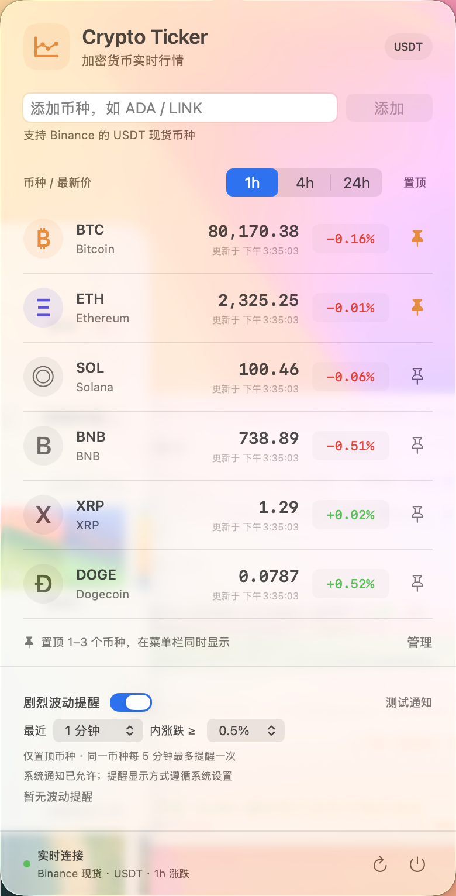

# Crypto Ticker

[English](README.md) | 简体中文

**在 macOS 菜单栏查看加密货币实时行情，让短时价格波动及时提醒你。**

Crypto Ticker 是使用 Swift、AppKit 和 SwiftUI 开发的原生菜单栏应用。把关注的币种置顶后，无需切换窗口即可查看价格和涨跌方向；点击菜单栏价格，展开自选行情、涨跌窗口与波动提醒设置。

支持 **macOS 13+**，使用 Binance 公共现货行情，以 **USDT** 报价，无需账户或 API Key，无第三方依赖。

界面跟随 macOS 系统语言，支持**简体中文和英文**；无法匹配到支持的语言时回退到英文，无需在应用内切换。修改系统或应用语言后，重启 Crypto Ticker 生效。行情面板、错误提示、辅助功能标签和通知使用同一语言。

## 界面截图

**完整菜单栏**：显示置顶币种的最新价格、当前涨跌窗口和方向。点击图片可查看原图。

<p>
  <a href="docs/images/menu-bar.png"></a>
</p>

**行情面板**：自定义币种、切换 1h / 4h / 24h 涨跌，设置短时波动提醒。

<p>
  
</p>

截图来自实际运行的应用，行情和提醒参数为拍摄时的状态。

## 功能

| 功能 | 说明 |
| --- | --- |
| 实时行情 | WebSocket 约每秒推送价格，连接时通过 REST 获取行情快照 |
| 自定义币种 | 支持 Binance 的 USDT 现货交易对，最多关注 50 个币种 |
| 菜单栏置顶 | 同时显示 1–3 个币种，币种列表与置顶选择自动保存 |
| 涨跌窗口 | 支持 1h、4h、24h，列表百分比、颜色和菜单栏箭头同步切换 |
| 波动提醒 | 只监测置顶币种，可调整时间范围和涨跌阈值，并可随时关闭 |
| 系统通知 | 支持 macOS 通知和提示音，提供「测试通知」按钮 |
| 系统语言 | 自动匹配简体中文或英文，不单独保存语言偏好 |
| 原生交互 | 菜单栏常驻、无 Dock 图标；浮窗位置稳定，滚动条默认隐藏，输入框点击后才聚焦 |
| 连接恢复 | 断线自动重连，显示过期状态，睡眠时暂停、唤醒后恢复 |

## 快速开始

准备 macOS 13 或更高版本，以及含 Swift 5.9+ 的 Xcode / Command Line Tools。在项目根目录执行：

```sh
zsh scripts/build-app.sh
open "dist/Crypto Ticker.app"
```

构建结果位于 `dist/Crypto Ticker.app`。也可以双击启动，或拖到「应用程序」目录后使用。

启动后在屏幕顶部菜单栏查看行情，点击价格打开面板，点击面板右下角的电源按钮退出。应用不显示 Dock 图标。

## 使用方式

### 管理自选币种

默认包含 BTC、ETH、SOL、BNB、XRP、DOGE，默认置顶 BTC。

1. 在输入框填写币种代码，例如 `ADA`、`LINKUSDT` 或 `ADA/USDT`，点击「添加」。应用验证交易对可用后开始订阅行情。
2. 点击币种右侧的图钉，将其显示在菜单栏；最多置顶 3 个，至少保留 1 个。
3. 点击「管理」移除不再关注的币种。列表至少保留 1 个币种；移除最后一个置顶币种时，会自动置顶列表首项。

列表可通过鼠标滚轮或触控板上下滚动。添加币种和刷新价格会保留浏览位置，细浮动滚动条在滚动时显示。菜单栏空间不足时，可减少置顶币种。

### 切换涨跌窗口

点击列表表头的 **1h / 4h / 24h**，查看对应窗口的涨跌。绿色表示上涨，红色表示下跌；菜单栏箭头使用同一窗口，选择会自动保存。

切换时会重新获取快照和实时订阅，新数据到达前显示等待状态。1h、4h 使用交易所滚动窗口，起点按分钟对齐，实际统计跨度可能比标称时间多不到一分钟；24h 使用 24 小时 ticker。

### 开启剧烈波动提醒

在面板下方打开「剧烈波动提醒」。该功能默认关闭，默认规则为 **1 分钟内实际价格涨跌达到 1%**。

| 设置 | 可选值 |
| --- | --- |
| 监测时长 | 1、5、15 分钟 |
| 涨跌阈值 | 0.5%、1%、2%、3%、5%、10% |
| 监测范围 | 当前置顶到菜单栏的币种 |
| 冷却时间 | 同一币种每 5 分钟最多提醒一次 |

提醒使用开启后采集的实时价格，以监测区间内最早的有效采样价为基准，上涨和下跌都可以触发，独立于 1h / 4h / 24h 的展示窗口。

触发后，对应币种在菜单栏显示 `⚡` 30 秒，面板保留最近一条提醒。首次开启时，macOS 会请求通知权限；允许后可同时接收系统通知及提示音。开关和规则自动保存。

点击「测试通知」检查系统通知是否可用。若没有横幅，可在「系统设置 → 通知 → Crypto Ticker」检查通知权限、显示方式与声音，并检查专注模式。不允许系统通知时，菜单栏和面板提示仍然可用。

### 连接状态

- 断线后按 2–30 秒退避自动重连，也可点击面板底部的刷新按钮手动重连。
- 超过 20 秒未更新的报价会标记过期，菜单栏显示 `◌`，保留上次价格供查看。
- 系统睡眠时暂停连接，唤醒后恢复。切换窗口、重新连接或采样中断超过 20 秒后，波动监测会重新建立价格基准；首条行情和 REST 快照不会直接触发提醒。

## 开发与验证

项目通过 Swift Package Manager 管理，可在 Xcode 中打开 [Package.swift](Package.swift)。

```text
Sources/
  CryptoTicker/           菜单栏、SwiftUI 面板、行情连接与系统通知
  CryptoTickerCore/       行情解析、币种管理、时间窗口与波动检测
    Resources/           中英文文案，由 SwiftPM 打包
Tests/
  CryptoTickerCoreTests/  行情与提醒规则测试
  CryptoTickerTests/      滚动行为与设置保存测试
Resources/Info.plist      应用标识与菜单栏运行配置
scripts/build-app.sh     Release 构建、打包与本机签名
docs/images/             README 的实际界面截图
```

运行离线测试：

```sh
swift test
```

测试覆盖行情解析、交易对校验、自选列表、涨跌窗口、滚动位置、波动阈值、冷却时间与设置恢复。

验证真实行情接口：

```sh
swift run CryptoTicker --check-feed
swift run CryptoTicker --check-feed --window 1h
swift run CryptoTicker --check-feed --window 4h
```

每次检查会获取 REST 快照并接收 3 条 WebSocket 行情，然后退出，需要联网。系统通知请使用打包后的 `.app` 验证。

验证打包后的语言资源（仅覆盖当前进程的测试语言，不修改系统设置）：

```sh
"dist/Crypto Ticker.app/Contents/MacOS/CryptoTicker" --check-localization -AppleLanguages '(en)' -AppleLocale en_US
"dist/Crypto Ticker.app/Contents/MacOS/CryptoTicker" --check-localization -AppleLanguages '(zh-Hans)' -AppleLocale zh_CN
```

打包脚本生成当前 Mac 架构的应用并进行 ad-hoc 签名，适合本机运行；对外分发需要开发者签名和公证。

## 数据源

行情来自 Binance 公共市场数据接口，不读取账户或交易权限：

| 用途 | 接口 |
| --- | --- |
| 24h 行情快照 | `https://data-api.binance.vision/api/v3/ticker/24hr` |
| 1h / 4h 行情快照 | `https://data-api.binance.vision/api/v3/ticker`，携带 `windowSize` 与币种参数 |
| 交易对验证 | `https://data-api.binance.vision/api/v3/exchangeInfo` |
| 实时行情 | `wss://data-stream.binance.vision/stream`，订阅所选币种与时间窗口 |

协议参考：[公开行情接口](https://github.com/binance/binance-spot-api-docs/blob/master/faqs/market_data_only.md)、[24h ticker](https://github.com/binance/binance-spot-api-docs/blob/master/web-socket-streams.md#individual-symbol-ticker-streams)、[滚动窗口行情](https://github.com/binance/binance-spot-api-docs/blob/master/web-socket-streams.md#individual-symbol-rolling-window-statistics-streams)。
